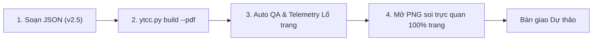

# QUY CHUẨN AN TOÀN HỆ THỐNG & ĐIỀU KHIỂN TIẾN TRÌNH (KHOA YTCC)

---

## 1. Thứ bậc Nguồn Dữ liệu (S0 > S1 > S2)
- **S0 (Nguồn Chân lý Gốc):** Toàn bộ các file PDF thực tế được lưu tại `knowledge_base/sample_pdfs/` và bản chụp/scan văn bản thực tế. Đây là căn cứ tối thượng để xác định thể thức, vạch kẻ, tọa độ và bố cục trang.
- **S1 (Nguồn Dẫn xuất Tra cứu):** CSDL SQLite `ytcc_history.db` và các tệp JSON lịch sử (`cv_di_history.json`, `cv_den_history.json`). Chỉ dùng cho mục đích tra cứu nhanh từ khóa, trích yếu, số hiệu và tìm PDF liên quan.
- **S2 (Tạo phẩm Phái sinh):** Toàn bộ file JSON kịch bản, file DOCX, PDF do AI tạo ra. Bắt buộc phải đối chiếu và kiểm chứng với chuẩn S0 trước khi nghiệm thu bàn giao.

---

## 2. Quy trình 4 Bước Bắt buộc Trước khi Bàn giao Văn bản (v2.5)
Mọi văn bản trước khi bàn giao cho người dùng hoặc chuyển Reviewer nghiệm thu bắt buộc phải trải qua đủ 4 bước tuần tự khép kín:

1. **Bước 1 — Soạn JSON:** Lắp ráp file dữ liệu JSON chuẩn theo `knowledge_base/specs/doc_schema.md` (hỗ trợ Inline Markdown `***...***`, `**...**`, `*...*`, bí danh `p`, `h1`-`h3`, `quote`).
2. **Bước 2 — Sinh DOCX & PDF:** Gọi `tools/ytcc.py build <file.json> --pdf` (hoặc `tools/ytcc.py batch <batch.json>` cho nhiều file). Lệnh tự động chạy qua Validator (`validate_schema`) và Linter (`lint_doc`), sau đó xuất Word COM và PDF.
3. **Bước 3 — Kiểm định Tự động & Telemetry:** `tools/inspect_pdf.py` tự động rà soát kích thước trang, rớt chữ NAM, lặp V/v, số trang, biến rác, và telemetry lố trang (`OVERFLOW_PAGE_2`). Nếu phát hiện `OVERFLOW_PAGE_2`, bắt buộc quay lại sửa JSON để văn bản co gọn vừa khít 1 trang.
4. **Bước 4 — Thẩm định Thị giác 100%:** Agent bắt buộc phải **mở trực tiếp toàn bộ ảnh PNG** được render ra (`read_file`) để kiểm tra bằng mắt thường (độ liền nét vạch kẻ, cân đối lề trang, tiêu đề bảng, ô phê duyệt BGH, làm sạch ký tự `*`). Nếu phát hiện lỗi thẩm mỹ, phải quay lại sửa JSON hoặc engine cho đến khi đạt độ hoàn thiện cao nhất.

---

## 3. Ràng buộc Kỹ thuật Windows & An toàn Word COM
- **Định dạng file mã nguồn PowerShell:** Mọi file `.ps1` có chứa tiếng Việt bắt buộc phải được lưu ở định dạng **UTF-8 with BOM** để PowerShell 5.1 xử lý đúng chuỗi Unicode tiếng Việt.
- **Tuyệt đối không dùng lệnh kill tiến trình hàng loạt:**
  - **CẤM:** Không được chạy `Stop-Process -Name WINWORD` hoặc `taskkill /F /IM WINWORD.EXE`. Lệnh này sẽ làm tắt đột ngột các tài liệu Word cá nhân mà người dùng đang mở trên máy tính.
  - **ĐÚNG:** Mọi thao tác xuất Word COM phải gói trong khối `try { ... } finally { $doc.Close(0); $word.Quit(); [Marshal]::ReleaseComObject(...) }` như đã thiết kế trong `tools/export_pdf.ps1`.
- **Không chạy song song nhiều tiến trình Word COM:**
  - Các tác vụ xuất PDF phải được Main Worker thực thi tuần tự, từng file một. Tuyệt đối không spawn subagent để xuất Word COM đồng thời.
- **Bảo mật thông tin:**
  - Tuyệt đối không ghi thông tin tài khoản, mật khẩu CSDL MySQL, IP mạng nội bộ hay khóa giải mã vào bất kỳ file mã nguồn, file cấu hình hay báo cáo markdown nào.
