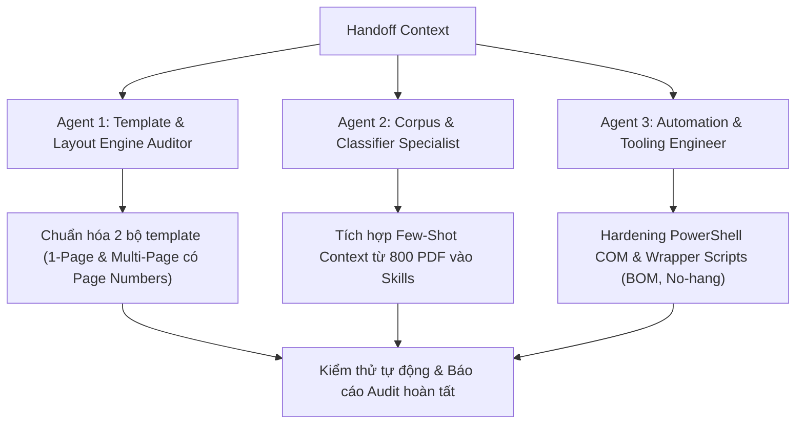

# TÀI LIỆU BÀN GIAO TOÀN DIỆN HỆ THỐNG QUẢN LÝ VĂN BẢN KHOA Y TẾ CÔNG CỘNG
*(Handoff Context for AI Agents - System Audit & Optimization Plan)*

---

## 1. TỔNG QUAN HỆ THỐNG & BỐI CẢNH DỰ ÁN
* **Đơn vị chủ quản:** Khoa Y tế Công cộng (YTCC) – Đại học Y Dược TP. Hồ Chí Minh (UMP).
* **Vị trí Workspace trên máy:** `D:\TH\vanban-ytcc`
* **Vị trí ứng dụng cũ:** `D:\Hương\QUANLYVANBAN`
* **GitHub Repository:** Private Repo: `https://github.com/khoa-ytcc/vanban-ytcc` (Tài khoản hoạt động: `thuhuongytcc`).
* **Mục tiêu cốt lõi:**
  1. Hỗ trợ chuyên viên/văn thư xử lý văn bản đến (nhận từ Trường/đơn vị ngoài) để soạn thảo văn bản đi (Công văn, Tờ trình, Giấy giới thiệu, Kế hoạch, Báo cáo,...).
  2. Tự động hóa tạo file Word `.docx` và xuất `.pdf` chuẩn thể thức hành chính theo **Nghị định 30/2020/NĐ-CP** và quy chuẩn riêng của Đại học Y Dược TP.HCM / Khoa YTCC.
  3. Sử dụng toàn bộ kho dữ liệu thực tế lịch sử (CSDL MySQL đám mây + File Excel lưu trữ + 800 bản scan PDF gốc) làm nền tảng tri thức mẫu (Knowledge Base / Few-shot Reference) để AI học và ứng dụng chính xác.

---

## 2. KẾT QUẢ DỊCH NGƯỢC HỆ THỐNG CŨ (REVERSE ENGINEERING)
### 2.1. Cấu hình CSDL Đám mây (MySQL)
* **Host:** `45.117.169.194` | **Port:** `3306`
* **Database:** `dvdung_dbase`
* **User:** `dvdung_user`
* **Mật khẩu đã giải mã:** `D0.4nhuy` (Giải mã từ thuật toán TripleDES khóa `KDAX19KQK54MZ` trong mã nguồn `QLVanBanDi.exe`).
* **Các bảng dữ liệu chính:**
  * `cv_di_qlvb`: Bảng văn bản đi (3.316 dòng tổng do các lần sao lưu trước đây import dồn; có **944 văn bản đi duy nhất** trong năm 2026; 762 link Google Drive dẫn tới file PDF scan).
  * `cv_den_qlvb`: Bảng văn bản đến (10.141 dòng; 9.855 link Google Drive).
  * `_cv_di_qlvb_ytcc_backup`: Dữ liệu sao lưu giai đoạn 2019-2022 (707 dòng).

### 2.2. Giải mã hiện tượng hiển thị trên App `QLVanBanDi`
* **Hiện tượng:** Tiêu đề App ghi *"Tổng cộng đến 18/06/2022: 415 Rec"*, nhưng danh sách lại có văn bản năm 2026 tới số 922/944.
* **Nguyên nhân kỹ thuật:** Chuỗi này bị **hardcode (viết cứng)** trong sự kiện `Form1_Load` khi tác giả biên dịch phần mềm năm 2022. CSDL MySQL thực tế vẫn được ghi liên tục đến hiện tại (2026).
* **Số ở góc trái dưới form:** Hiển thị số lượng bản ghi thỏa mãn điều kiện lọc theo ngày (ví dụ `48` văn bản từ 01/11/2026 đến nay).

---

## 3. TÀI SẢN KHO TRI THỨC (KNOWLEDGE BASE ASSETS)
Tất cả đã được trích xuất và lưu trữ cục bộ tại `D:\TH\vanban-ytcc\knowledge_base\`:
1. **Dữ liệu văn bản đi lịch sử:**
   * File: `knowledge_base/metadata_index/cv_di_history.json` (2.960 bản ghi từ 2023-2026, đầy đủ trích yếu, người ký, số đi, cán bộ xử lý/nơi nhận).
2. **Dữ liệu văn bản đến:**
   * File: `knowledge_base/metadata_index/cv_den_history.json` (3.873 bản ghi văn bản đến 2025-2026).
3. **Thống kê cơ quan gửi & nơi nhận:**
   * File: `knowledge_base/metadata_index/recipient_summary.json`.
4. **Kho file PDF scan thực tế đầy đủ 100%:**
   * Vị trí: `knowledge_base/sample_pdfs/`
   * Tổng số file: **800 files PDF** (Đã tải trọn vẹn 762 file độc nhất từ Google Drive + các file kiểm thử, dung lượng **1.47 GB**, 0 lỗi).

---

## 4. KẾT QUẢ NGHIÊN CỨU ĐỊNH LƯỢNG KHO MẪU (EMPIRICAL CORPUS AUDIT)
Kết quả phân tích 800 file PDF thực tế của Khoa YTCC bằng `tools/analyze_corpus_stats.ps1`:
* **Phân bố số trang thực tế:**
  * **1 trang:** 277 văn bản (34.6%)
  * **2 trang:** 212 văn bản (26.5%)
  * **3 trang:** 79 văn bản (9.9%)
  * **4 trang:** 56 văn bản (7.0%)
  * **5 trang:** 32 văn bản (4.0%)
  * **6 - 10 trang:** 83 văn bản (10.4%)
  * **11+ trang:** 61 văn bản (7.6%)
* **Phân bố theo thể loại văn bản:**
  * **Công văn (200 văn bản):** 55.0% là 1 trang (110 bản), 45% là nhiều trang (trung bình 2.6 trang). Các công văn ngắn (phúc đáp, đồng ý/cử cán bộ, thông báo nhanh) là 1 trang; công văn có danh sách đính kèm, bảng biểu phân công là 2-4 trang.
  * **Tờ trình (125 văn bản):** Chỉ 26.4% là 1 trang, **73.6% là nhiều trang** (trung bình 3.6 trang) vì có phần thuyết minh sự cần thiết và bảng dự trù kinh phí.
  * **Kế hoạch (141 văn bản):** **74.5% là nhiều trang** (trung bình 4.2 trang) gồm mục đích, nội dung, tiến độ, phân công.
  * **Báo cáo (65 văn bản):** **86.2% là nhiều trang** (trung bình 6.5 trang).
  * **Giấy giới thiệu (87 văn bản):** 42.5% là 1 trang; loại nhiều trang là do có phụ lục danh sách học viên/sinh viên đi kèm.
  * **Quy định / Quyết định (22 văn bản):** **81.8% là nhiều trang** (trung bình 2.3 - 5 trang).

---

## 5. QUY TẮC ĐỊNH DẠNG THÍCH ỨNG (ADAPTIVE PAGINATION & LAYOUT RULES)
> [!IMPORTANT]
> **Hướng dẫn của User:** Độ dài văn bản phụ thuộc vào tính chất và nội dung, KHÔNG ép cứng mọi văn bản vào 1 trang! Cần thiết lập quy tắc thích ứng khoa học.

### Nhóm A: Văn bản ngắn (Mục tiêu: Gói gọn 1 mặt giấy A4)
* **Áp dụng cho:**
  * Công văn hành chính thông thường (đồng ý/cử viên chức, phúc đáp văn bản đến ngắn, xác nhận, giấy mời họp).
  * Giấy giới thiệu (GGT) cho cá nhân hoặc nhóm nhỏ.
  * Tờ trình ngắn (xin chủ trương đơn giản 1 nội dung).
* **Quy chuẩn kỹ thuật:**
  * Cột 1 (Header trái): 195 - 200 pt. Cột 2 (Header phải): 253 - 258 pt. Lề trái 3cm (85 pt), lề phải 2cm (56.7 pt), lề trên 2cm, lề dưới 2cm.
  * Cỡ chữ nội dung: 11.5 - 12 pt. Line spacing: 12 - 13 pt (single compact).
  * SpaceBefore / SpaceAfter giữa các đoạn: 0 - 2 pt.
  * **Mục tiêu sống còn:** Tuyệt đối không để khối chữ ký hoặc nơi nhận bị rớt sang trang 2 (lỗi "góa phụ" - orphan signature).

### Nhóm B: Văn bản trung bình & nhiều trang (2 trang đến 10+ trang)
* **Áp dụng cho:** Kế hoạch (KH), Báo cáo (BC), Tờ trình dự án/kinh phí chi tiết (TTr), Quy định/Quy chế (QĐ), Công văn kèm bảng biểu/danh sách.
* **Quy chuẩn kỹ thuật theo Nghị định 30/2020/NĐ-CP:**
  * **Đánh số trang:** Phải có số trang đặt tại góc phải hoặc giữa ở lề trên/lề dưới (thường là lề trên giữa hoặc lề dưới giữa, font Times New Roman 13-14 pt đứng, không đánh số trang ở trang thứ nhất).
  * **Quy tắc chữ ký trang cuối:** Trang cuối cùng có khối chữ ký **bắt buộc phải có tối thiểu 3 đến 5 dòng nội dung văn bản** đi kèm; tuyệt đối cấm đẩy toàn bộ chữ ký sang một trang trắng riêng lẻ.
  * **Bảng biểu kéo dài qua trang:** Phải bật thuộc tính `Repeat Header Row` (lặp lại dòng tiêu đề cột trên mỗi trang mới).
  * **Phụ lục kèm theo:** Ghi rõ *"Kèm theo Công văn/Kế hoạch số.../YTCC-VP ngày... tháng... năm..."* ở góc trên bên phải trang phụ lục.

---

## 6. KIỂM TOÁN HỆ THỐNG HIỆN TẠI (SYSTEM AUDIT)
### Điểm mạnh:
* Đã dịch ngược thành công toàn bộ hệ thống cũ, nắm trọn CSDL và luồng dữ liệu.
* Đã tải toàn bộ kho dữ liệu thực tế 800 PDF (1.47 GB) và 2.960 metadata records.
* Bộ template Word `.docx` cơ bản và các script PowerShell chạy trực tiếp COM Automation không phụ thuộc bên ngoài.
* Đã thiết lập Private Git Repo với `gh` CLI.

### Tồn tại & Rủi ro cần cải tiến (Giao cho Worker AI Agents xử lý):
1. **Xử lý Word COM:** Các script PowerShell dùng Word COM đôi lúc bị treo nếu gọi phương thức tạo hộp thoại (`SaveAs2` với tham số không tương thích hoặc tài khoản Office 365 hiển thị prompt đám mây). Cần chuẩn hóa hàm wrapper an toàn: Copy template -> Open -> Edit -> Save -> ExportPDF -> Close -> Quit.
2. **Encoding Tiếng Việt trên PowerShell:** Windows PowerShell 5.1 mặc định đọc ANSI (Windows-1252), bắt buộc mọi file `.ps1` phải có **UTF-8 with BOM** (`EF BB BF`), nếu không sẽ lỗi ký tự tiếng Việt.
3. **Phân tách Template:** Cần tách rõ 2 bộ template:
   * Bộ template **Compact 1-Page** (cho công văn ngắn, tờ trình ngắn, giấy giới thiệu).
   * Bộ template **Standard Multi-Page** (có sẵn Header/Footer số trang, quy định ngắt trang, khối chữ ký kèm đoạn kết).
4. **Hệ thống Skills AI:** Các skill trong `.agents/skills/` cần được nạp các mẫu câu thực tế học từ 800 file PDF (ví dụ: công văn phúc đáp HTV7, công văn cử đi đào tạo, tờ trình mở khóa điểm, giấy giới thiệu thực tập).

---

## 7. KẾ HOẠCH HÀNH ĐỘNG CHO WORKER AI AGENTS (WORKER ACTION PLAN)

### Nhiệm vụ cụ thể cho từng Worker:
1. **Worker Agent 1 (Layout & Template Engineer):**
   * Hoàn thiện `knowledge_base/templates/` với 2 biến thể cho mỗi loại văn bản: `_1Page.docx` và `_MultiPage.docx`.
   * Cài đặt Page Numbering tự động cho bản Multi-Page theo Nghị định 30.
   * Cập nhật quy tắc chữ ký trang cuối không bị cô lập.
2. **Worker Agent 2 (Knowledge & NLP Specialist):**
   * Xây dựng chỉ mục trích xuất nội dung mẫu (Few-shot Examples) từ 800 PDF đã tải, phân loại theo 10 kịch bản công việc thường gặp nhất của Khoa YTCC.
   * Cập nhật 4 skills (`ytcc-classify-doc`, `ytcc-reply-incoming`, `ytcc-draft-writer`, `ytcc-docx-export`).
3. **Worker Agent 3 (System & Tooling Hardener):**
   * Kiểm toán toàn bộ script trong `tools/`: đảm bảo 100% file `.ps1` có UTF-8 with BOM.
   * Viết hàm chuyển đổi PDF tối ưu, bắt ngoại lệ COM an toàn, tự động dọn dẹp tiến trình `WINWORD.EXE`.
   * Cập nhật kịch bản tạo văn bản thông minh: Tự động phát hiện dung lượng nội dung -> Nếu ngắn dùng template 1-Page, nếu dài tự chuyển sang template Multi-Page.

---
*Tài liệu được khởi tạo và đồng bộ tại `D:\TH\vanban-ytcc\HANDOFF.md` - Sẵn sàng cho lượt tiếp theo của AI Agents.*
